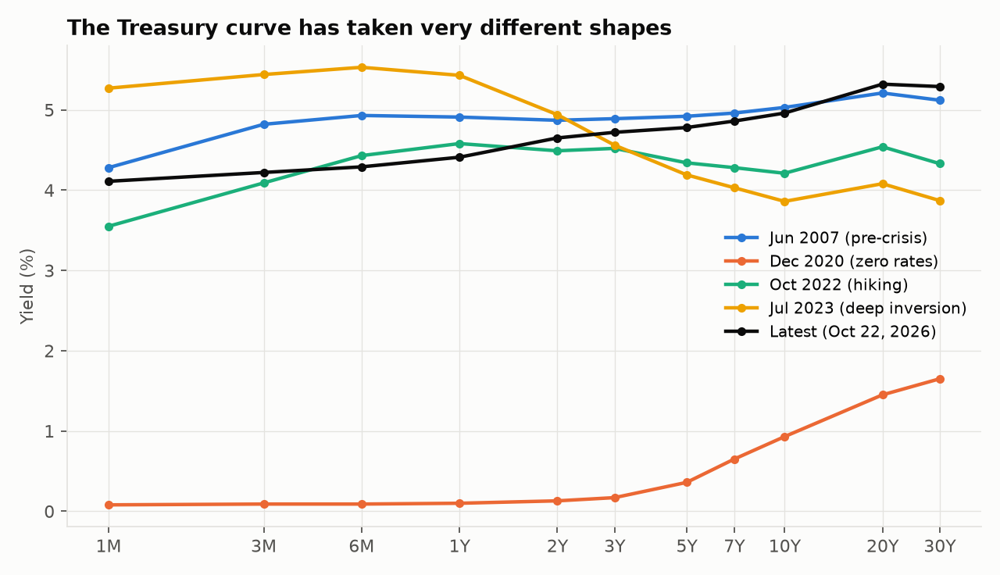
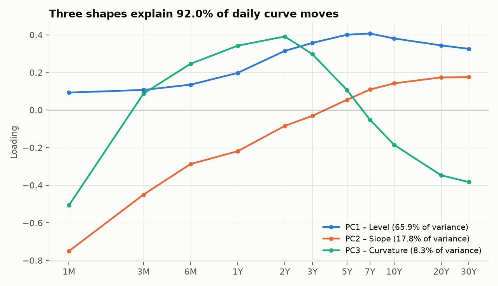
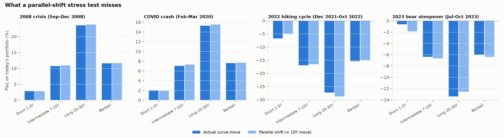
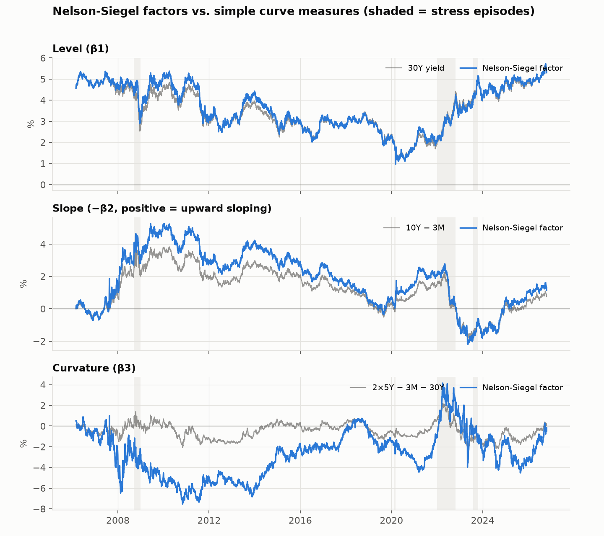
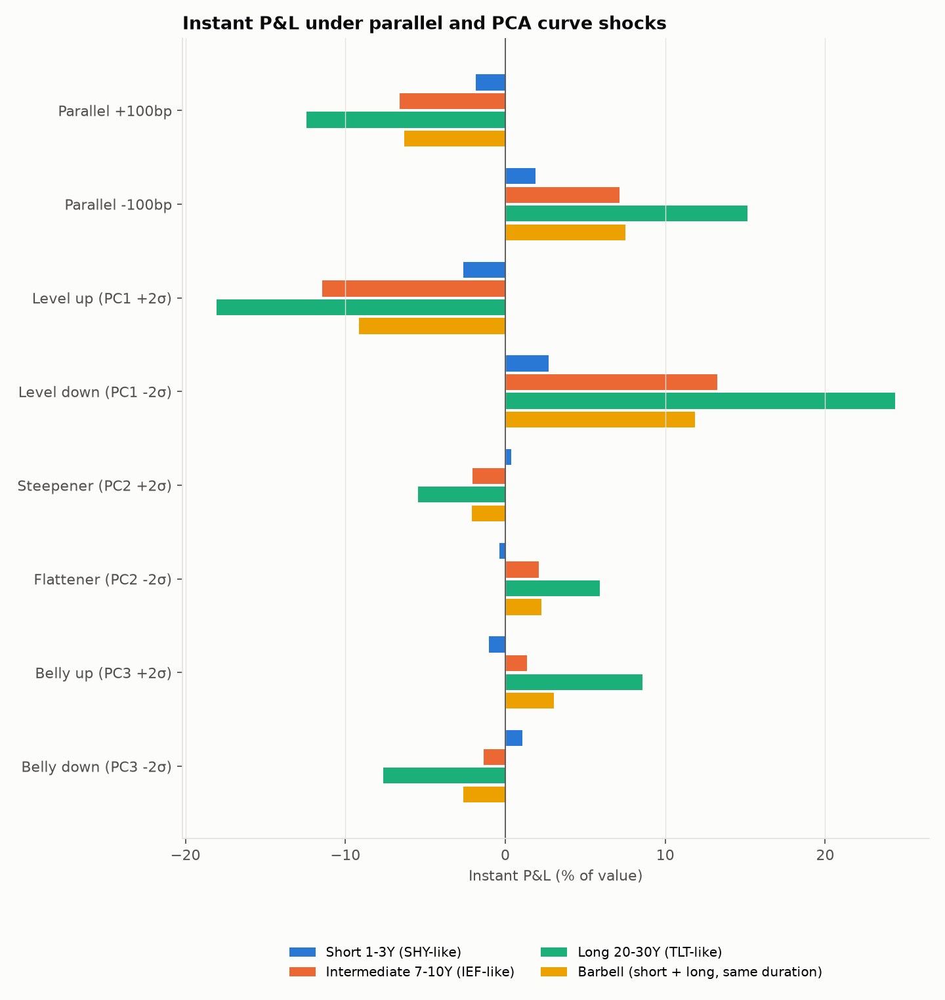

# Treasury Yield Curve Analysis

**What does a parallel-shift stress test miss?**

Most bond stress tests, including the ±100 bp rate shock my student-managed fund uses, assume every
maturity moves by the same amount. Real curves rarely do. This project models how the U.S. Treasury
curve actually moves, then stress-tests simple Treasury portfolios under realistic curve shocks and
compares the results with a parallel shift.

Built in Python with 5,167 trading days of FRED data (1M–30Y), March 2006 to October 2026.

## Key findings

- **Three shapes drive the curve.** Level, slope and curvature explain **92.0%** of daily
  moves in Treasury yields (level alone: 65.9%).
- **Nelson-Siegel tracks the market closely.** Its level and slope factors correlate 0.99 and
  1.00 with the 30Y yield and the 10Y–3M spread.
- **Parallel shocks misjudged 2022.** The 10Y rose 269 bp while 2s10s flattened 107 bp. A
  parallel shock matched to the 10Y move predicted a 4.9% loss on short 1–3Y Treasuries; the
  actual curve move produced 6.7%, an understatement of about 38%. It also overstated the
  long-bond (20–30Y) loss by 1.5 pts.
- **The error flips in a steepener.** In the 2023 bear steepener, the same parallel shock
  overstated the short-bond loss about threefold (1.9% vs. 0.6%).
- **Equal duration behaved almost identically.** A barbell and a 7–10Y bullet with the same
  duration differed by less than 0.5 pts in every scenario, so for these portfolios the
  curve-shape risk sits in which maturities you hold, not in how you combine them.

## Charts

| | |
|---|---|
|  |  |





## Method

**1. Data.** Daily constant-maturity Treasury yields for 11 maturities (1M–30Y) from FRED, starting
March 2006, the first month with a full curve after the 30Y was reissued.

**2. Nelson-Siegel.** Each day's curve is fitted with three factors (level, slope, curvature). Following
Diebold & Li (2006), λ is fixed at 0.0609 per month, which turns each day's fit into a simple linear
regression. Average fit error is 10.5 bp.

**3. PCA.** Principal component analysis on daily yield changes (in bp) finds the shapes the curve moves in
most often, without assuming them in advance. The first three components line up with the Nelson-Siegel
factors (correlations of 0.83, 0.78 and 0.83 on daily changes).

**4. Stress tests.** Four Treasury portfolios are priced at par off the latest curve and fully repriced
(including convexity) under each scenario:

| Portfolio | Proxy for | Duration |
|---|---|---|
| Short 1–3Y | SHY | 1.9 |
| Intermediate 7–10Y | IEF | 6.9 |
| Long 20–30Y | TLT | 13.7 |
| Barbell (58% short / 42% long) | — | 6.9 |

Scenarios:
- **Parallel ±100 bp:** the standard rate shock
- **PCA shocks:** a 2-standard-deviation, one-year move in level, slope and curvature
- **Historical replays:** the actual curve change during the 2008 crisis, the COVID crash, the 2022 hiking
  cycle and the 2023 bear steepener, applied to today's curve and compared with a parallel shift equal to
  the 10Y's move

## Results

| Episode | 10Y move | 2s10s change | Short 1–3Y: actual vs. parallel | Long 20–30Y: actual vs. parallel |
|---|---|---|---|---|
| 2008 crisis (Sep–Dec 2008) | −149 bp | −2 bp | +2.9% vs. +2.9% | +23.6% vs. +23.8% |
| COVID crash (Feb–Mar 2020) | −102 bp | +2 bp | +2.0% vs. +1.9% | +15.3% vs. +15.5% |
| 2022 hiking cycle (Dec 2021–Oct 2022) | +269 bp | −107 bp | **−6.7% vs. −4.9%** | −27.3% vs. −28.8% |
| 2023 bear steepener (Jul–Oct 2023) | +101 bp | +75 bp | **−0.6% vs. −1.9%** | −13.4% vs. −12.6% |

When the curve moved roughly in parallel (2008, 2020), a parallel shock worked well. When the slope moved
too (2022, 2023), it misjudged short-maturity losses badly. Full tables are in `outputs/summary.md`.

## Run it

```bash
pip3 install -r requirements.txt
python3 run_analysis.py            # downloads data from FRED on the first run, then uses the cache
python3 run_analysis.py --refresh  # pull the latest data
```

Results are saved to `outputs/`: charts in `figures/`, CSV tables, and `summary.md` with every number above.

## Project structure

```
run_analysis.py        main script
src/data.py            FRED download and cleaning
src/nelson_siegel.py   curve fitting
src/pca.py             principal components of daily changes
src/stress.py          bond pricing, portfolios and scenarios
src/plots.py           charts
```

## Limitations

- Portfolios are made of plain Treasury bullets, not real ETF holdings. They have similar durations but no
  credit or roll-down effects.
- Historical replays apply each episode's curve change to today's curve and portfolios, not to the bonds
  held at the time.
- Shocks are instantaneous, so they ignore carry over the horizon.
- Constant-maturity yields are interpolated by the Treasury and are close to, but not the same as, the yields
  on traded bonds.

## Related

[Macro Regime Analysis (R)](https://github.com/ChrisAhle/Macro-Regime-Analysis): asset-class returns
across growth and inflation regimes.
